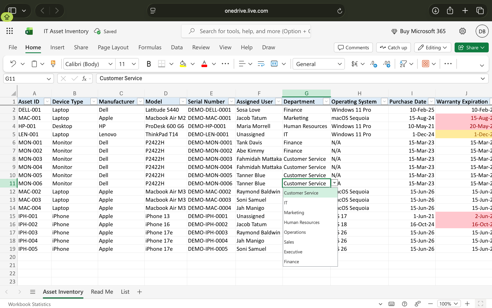

# IT-Asset-Inventory-Management
A hands-on IT asset management project using Microsoft Excel to track company devices, hardware details, assigned users, device status, and warranty expiration dates. Includes dropdown menus, conditional formatting and automated warranty tracking to simulate real-word IT help desk and endpoint management task.

## Overview
This project simulates how an IT Helpdesk or asset management team keeps an accurate record of company hardware: what each device is, who has it, what condition it's in and when its warranty runs out.

## Tools Used
- Microsoft Excel
- Data Validation
- Conditional Formatting
- Excel Formulas

## Features
- **Devices and hardware tracking:** a record for each company device with its hardware details
- **Assigned user tracking:** tracks the employees responsible for each device
- **Device status:** dropdown menus to identify each device's current status
- **Dropdown menus:** data validation keep entries consistent and prevent typos
- **Conditional formatting:** Color-coded highlighting makes important device information easy to identify
- **Automated warranty tracking:** Uses formulas to identify expired and upcoming warranty expirations

## How It Works
- **Dropdowns:** restrict entries to approved values using data validation
- **Conditional formatting:** highlights devices statuses and warranty dates using color-coded rules
- **Warranty tracking:** uses Excel formulas to compare warranty expiration dates against today's date and identify expired warranties and warranties expiring soon

## Project Screenshots
Screenshots demonstrating the inventory layout, dropdown menus, and project features will be displayed below.

## Project File 
The completed Excel workbook is included in this repository:

IT-Asset-Inventory.xlsx

## Sample Data
This project uses fictional employee names, device information, serial numbers, asset tags, and warranty dates for demonstration purposes. No real company or employee information is included.

## Excel Formulas
**Expired Warranty:**  '=AND(J2<TODAY(),J2<>"")'

-Identifies warranties that have already expired while ignoring blank cells.

**Upcoming Warranty (Next 30 Days):**  '=AND(J2>=TODAY(),J2<=TODAY()+30)'

-Identifies warranties that will expire within the next 30 days.

## Skills Demonstrated
- IT Asset Management
- Hardware Inventory Tracking
- Data Validation
- Conditional Formatting
- Basic Excel Formulas
- Endpoint and Help Desk Operations

### Project Screenshots

-Inventory Overview

-Dropdown Menus

